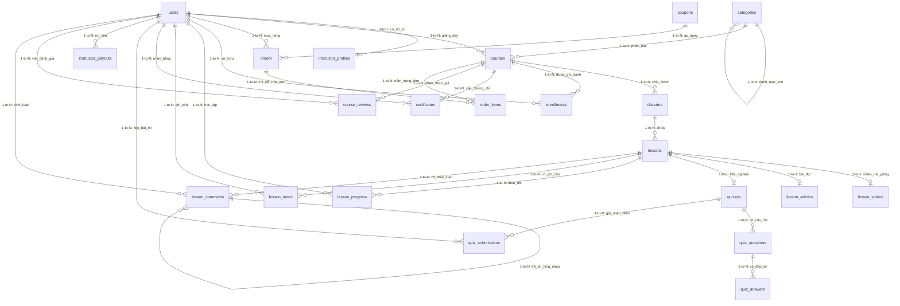

# TÀI LIỆU THIẾT KẾ CƠ SỞ DỮ LIỆU HỆ THỐNG LMS (MINI-UDEMY)
**Đề tài:** Xây dựng Website Quản lý Học tập Trực tuyến (LMS)  
**Công nghệ:** Laravel Framework & Hệ quản trị CSDL MySQL / MariaDB  
**Phiên bản tài liệu:** 1.1 (Cập nhật chuẩn hóa quan hệ bảng `coupons` và `orders`)

---

## MỤC LỤC
1. [TỔNG QUAN HỆ THỐNG DỮ LIỆU](#1-tổng-quan-hệ-thống-dữ-liệu)
2. [MÔ HÌNH DỮ LIỆU Ý NIỆM (CONCEPTUAL DATA MODEL - CDM)](#2-mô-hình-dữ-liệu-ý-niệm-conceptual-data-model---cdm)
3. [MÔ HÌNH DỮ LIỆU LUẬN LÝ (LOGICAL DATA MODEL - LDM)](#3-mô-hình-dữ-liệu-luận-lý-logical-data-model---ldm)
4. [MÔ HÌNH DỮ LIỆU VẬT LÝ & TỪ ĐIỂN DỮ LIỆU (PDM & DATA DICTIONARY)](#4-mô-hình-dữ-liệu-vật-lý--từ-điển-dữ-liệu-pdm--data-dictionary)
   - [Phân hệ 1: Người dùng, Phân quyền & Giảng viên (2 bảng)](#phân-hệ-1-người-dùng-phân-quyền--giảng-viên)
   - [Phân hệ 2: Khóa học & Nội dung Đa phương tiện (6 bảng)](#phân-hệ-2-khóa-học--nội-dung-đa-phương-tiện)
   - [Phân hệ 3: Đánh giá & Kiểm tra Trắc nghiệm (4 bảng)](#phân-hệ-3-đánh-giá--kiểm-tra-trắc-nghiệm)
   - [Phân hệ 4: Tiến độ Học tập, Ghi chú & Chứng chỉ (4 bảng)](#phân-hệ-4-tiến-độ-học-tập-ghi-chú--chứng-chỉ)
   - [Phân hệ 5: Thương mại, Đơn hàng & Tài chính (4 bảng)](#phân-hệ-5-thương-mại-đơn-hàng--tài-chính)
   - [Phân hệ 6: Tương tác & Cộng đồng (2 bảng)](#phân-hệ-6-tương-tác--cộng-đồng)
5. [SƠ ĐỒ THỰC THỂ QUAN HỆ (ERD - MERMAID)](#5-sơ-đồ-thực-thể-quan-hệ-erd---mermaid)
6. [HƯỚNG DẪN IMPORT VÀ CÔNG CỤ VẼ HÌNH BÁO CÁO](#6-hướng-dẫn-import-và-công-cụ-vẽ-hình-báo-cáo)

---

## 1. TỔNG QUAN HỆ THỐNG DỮ LIỆU

Hệ thống cơ sở dữ liệu được thiết kế nhằm đáp ứng đầy đủ chu trình nghiệp vụ của một nền tảng **E-learning Marketplace** kết hợp giữa tính năng thương mại (như **Udemy**) và trải nghiệm học tập tuần tự, tương tác cao (như **F8**):
* **Tính toàn vẹn tham chiếu (Referential Integrity):** Ràng buộc khóa ngoại nghiêm ngặt giữa các cấp: Danh mục $\rightarrow$ Khóa học $\rightarrow$ Chương $\rightarrow$ Bài học; Đơn hàng $\rightarrow$ Người dùng $\rightarrow$ Mã giảm giá $\rightarrow$ Chi tiết đơn hàng.
* **Chuẩn hóa dữ liệu (Database Normalization):** Đạt chuẩn dạng chuẩn 3 (3NF), triệt tiêu dư thừa dữ liệu nhưng vẫn tối ưu hóa hiệu năng truy vấn cho trình phát bài giảng (Video Player).
* **Kiểm toán & Đối soát tài chính (Audit Trail):** Mọi giao dịch tài chính đều được lưu vết đầy đủ từ giá mua gốc, mã giảm giá áp dụng (`coupon_id`), số tiền chiết khấu đến mã tham chiếu giao dịch cổng thanh toán.
* **Quy mô:** Bao gồm **22 bảng thực thể** được chia thành 6 phân hệ chức năng rõ ràng.

---

## 2. MÔ HÌNH DỮ LIỆU Ý NIỆM (CONCEPTUAL DATA MODEL - CDM)

Mô hình dữ liệu ý niệm xác định các thực thể nghiệp vụ cốt lõi, thuộc tính trừu tượng và các mối quan hệ ngữ nghĩa giữa chúng (chưa phụ thuộc vào công nghệ RDBMS cụ thể).

### 2.1. Danh sách các Thực thể (Entities)
1. **NGƯỜI DÙNG (User):** Đại diện cho mọi đối tượng truy cập (Học viên, Giảng viên, Quản trị viên).
2. **HỒ SƠ GIẢNG VIÊN (Instructor Profile):** Mở rộng thông tin chuyên môn, tài khoản ngân hàng và ví doanh thu.
3. **DANH MỤC (Category):** Phân loại khóa học theo chuyên ngành (có tính phân cấp cha - con).
4. **KHÓA HỌC (Course):** Sản phẩm đào tạo chính, có lộ trình, giá bán và trạng thái phê duyệt.
5. **CHƯƠNG HỌC (Chapter):** Phân đoạn nội dung cấp 1 trong khóa học.
6. **BÀI HỌC (Lesson):** Đơn vị học tập cấp 2 (có thể là Video, Bài đọc hoặc Bài kiểm tra).
7. **BÀI KIỂM TRA (Quiz):** Bộ câu hỏi đánh giá mức độ tiếp thu của học viên.
8. **CÂU HỎI & ĐÁP ÁN (Question & Answer):** Ngân hàng câu hỏi trắc nghiệm và các lựa chọn.
9. **ĐƠN HÀNG & CHI TIẾT (Order & Order Item):** Giao dịch mua bán khóa học và lưu trữ giá tại thời điểm giao dịch.
10. **MÃ GIẢM GIÁ (Coupon):** Chính sách khuyến mãi áp dụng cho đơn hàng để chiết khấu giá trị thanh toán.
11. **GHI DANH (Enrollment):** Quyền sở hữu khóa học của học viên.
12. **TIẾN ĐỘ BÀI HỌC (Lesson Progress):** Trạng thái hoàn thành và vị trí dừng xem video (Resume Playback).
13. **GHI CHÚ (Lesson Note):** Ý kiến ghi chú của học viên gắn với mốc thời gian (Timestamp) cụ thể của video.
14. **CHỨNG CHỈ (Certificate):** Văn bằng điện tử xác nhận hoàn thành khóa học kèm mã xác thực công khai.
15. **RÚT TIỀN (Payout):** Yêu cầu chuyển doanh thu từ ví giảng viên về tài khoản ngân hàng.
16. **ĐÁNH GIÁ (Review):** Nhận xét và số sao phản hồi chất lượng khóa học.
17. **BÌNH LUẬN (Comment):** Thảo luận, hỏi đáp đa tầng dạng cây đệ quy dưới bài học.

### 2.2. Bản số quan hệ (Cardinality / Multiplicity)
* `User` (1) —— (0..1) `Instructor Profile`
* `Category` (0..1) —— (0..N) `Category` *(Mối quan hệ phản thân: Danh mục cha - con)*
* `Category` (1) —— (0..N) `Course`
* `User [Giảng viên]` (1) —— (0..N) `Course`
* `Course` (1) —— (1..N) `Chapter`
* `Chapter` (1) —— (1..N) `Lesson`
* `Lesson` (1) —— (0..1) `Lesson Video` / `Lesson Article` / `Quiz` *(Chuyên biệt hóa nội dung)*
* `Quiz` (1) —— (1..N) `Quiz Question` (1) —— (2..N) `Quiz Answer`
* `Coupon` (0..1) —— (0..N) `Order` *(Một mã giảm giá có thể áp dụng cho nhiều đơn hàng; một đơn hàng có thể có 0 hoặc 1 mã giảm giá)*
* `User [Học viên]` (1) —— (0..N) `Order` (1) —— (1..N) `Order Item` (N) —— (1) `Course`
* `User [Học viên]` (1) —— (0..N) `Enrollment` (N) —— (1) `Course`
* `User` (1) —— (0..N) `Lesson Progress` (N) —— (1) `Lesson`
* `User` (1) —— (0..N) `Lesson Note` (N) —— (1) `Lesson`
* `User` (1) —— (0..N) `Certificate` (N) —— (1) `Course`
* `Lesson Comment` (0..1) —— (0..N) `Lesson Comment` *(Mối quan hệ phản thân: Cây thảo luận lồng nhau)*

---

## 3. MÔ HÌNH DỮ LIỆU LUẬN LÝ (LOGICAL DATA MODEL - LDM)

Mô hình luận lý chuyển đổi các thực thể ý niệm thành các bảng quan hệ, xác định rõ Khóa chính (Primary Key - PK), Khóa ngoại (Foreign Key - FK), bảng kết hợp giải quyết quan hệ Nhiều - Nhiều ($N-N$) và chuẩn hóa dữ liệu.

### 3.1. Biện luận Chuẩn hóa (Normalization to 3NF)
* **1NF (Dạng chuẩn 1):** Tất cả các thuộc tính đều mang giá trị nguyên tố (Atomic). Ví dụ: Các đáp án trắc nghiệm không gộp trong một chuỗi JSON mà tách riêng thành thực thể `quiz_answers`; mục tiêu khóa học không viết chung vào 1 cột văn bản lộn xộn.
* **2NF (Dạng chuẩn 2):** Đạt 1NF và mọi thuộc tính không khóa đều phụ thuộc hàm toàn phần vào Khóa chính. Trong bảng chi tiết đơn hàng `order_items`, giá bán `price` phụ thuộc vào cặp khóa `(order_id, course_id)` tại thời điểm giao dịch, không phụ thuộc riêng vào `course_id`.
* **3NF (Dạng chuẩn 3):** Đạt 2NF và không có thuộc tính không khóa nào phụ thuộc bắc cầu vào Khóa chính. Ví dụ: Bảng `lessons` không lưu `course_id` (tránh phụ thuộc bắc cầu qua `chapter_id`), thông tin khóa học được truy xuất thông qua `chapters`.

### 3.2. Giải quyết Quan hệ & Tính toàn vẹn tham chiếu
1. **User (Học viên) $N - N$ Course (Khóa học):**
   * Giải quyết bằng bảng liên kết `enrollments(user_id, course_id)`. Ràng buộc `UNIQUE(user_id, course_id)` ngăn chặn mua trùng lặp.
2. **Order (Đơn hàng) $N - N$ Course (Khóa học):**
   * Giải quyết bằng bảng liên kết `order_items(order_id, course_id, price)`.
3. **User (Học viên) $N - N$ Lesson (Bài học):**
   * Giải quyết bằng bảng liên kết `lesson_progress(user_id, lesson_id, is_completed, last_watch_second)`.
4. **Coupon (Mã giảm giá) $1 - N$ Order (Đơn hàng):**
   * Giải quyết thông qua khóa ngoại `orders.coupon_id` trỏ đến `coupons.id`. Thuộc tính này mang tính chất tùy chọn (cho phép `NULL` khi người dùng không sử dụng mã).
   * Ràng buộc xóa: `ON DELETE SET NULL`. Khi một mã giảm giá bị xóa hoặc hết hạn trong hệ thống quản trị, giá trị `coupon_id` trong các đơn hàng cũ sẽ chuyển về `NULL`, giúp bảo tồn nguyên vẹn các số liệu tài chính (`total_amount`, `discount_amount`, `final_amount`) mà không gây lỗi khóa ngoại hay sai lệch sổ sách kế toán.

---

## 4. MÔ HÌNH DỮ LIỆU VẬT LÝ & TỪ ĐIỂN DỮ LIỆU (PDM & DATA DICTIONARY)

Dưới đây là từ điển dữ liệu chi tiết của toàn bộ **22 bảng**, định dạng theo chuẩn hệ quản trị CSDL **MySQL 8.0+ / InnoDB Engine**, tương thích hoàn toàn với Migration của **Laravel Framework**.

---

### PHÂN HỆ 1: NGƯỜI DÙNG, PHÂN QUYỀN & GIẢNG VIÊN

#### 1. Bảng `users` (Tài khoản người dùng)
Lưu trữ thông tin xác thực của tất cả tác nhân (Student, Instructor, Admin).

| Tên cột | Kiểu dữ liệu | Khóa | Cho phép NULL | Mặc định | Ý nghĩa & Quy tắc nghiệp vụ |
| :--- | :--- | :---: | :---: | :---: | :--- |
| `id` | BIGINT UNSIGNED | **PK** | KHÔNG | Auto Increment | Mã định danh người dùng |
| `name` | VARCHAR(255) | | KHÔNG | | Họ và tên hiển thị |
| `email` | VARCHAR(255) | **UQ** | KHÔNG | | Email đăng nhập hệ thống (duy nhất) |
| `email_verified_at` | TIMESTAMP | | CÓ | NULL | Thời điểm xác thực email |
| `password` | VARCHAR(255) | | KHÔNG | | Mật khẩu mã hóa Bcrypt / Argon2 |
| `avatar` | VARCHAR(255) | | CÓ | NULL | Đường dẫn file ảnh đại diện |
| `role` | ENUM | | KHÔNG | 'student' | Vai trò: `'student'`, `'instructor'`, `'admin'` |
| `status` | ENUM | | KHÔNG | 'active' | Trạng thái: `'active'` (hoạt động), `'banned'` (bị khóa) |
| `remember_token` | VARCHAR(100) | | CÓ | NULL | Token duy trì đăng nhập của Laravel |
| `created_at` | TIMESTAMP | | CÓ | CURRENT_TIMESTAMP | Ngày tạo tài khoản |
| `updated_at` | TIMESTAMP | | CÓ | CURRENT_TIMESTAMP | Ngày cập nhật gần nhất |

#### 2. Bảng `instructor_profiles` (Hồ sơ chuyên sâu & Ví tiền Giảng viên)
Quan hệ $1 - 1$ với bảng `users` dành riêng cho những tài khoản có vai trò giảng viên.

| Tên cột | Kiểu dữ liệu | Khóa | Cho phép NULL | Mặc định | Ý nghĩa & Quy tắc nghiệp vụ |
| :--- | :--- | :---: | :---: | :---: | :--- |
| `id` | BIGINT UNSIGNED | **PK** | KHÔNG | Auto Increment | Mã hồ sơ giảng viên |
| `user_id` | BIGINT UNSIGNED | **FK, UQ** | KHÔNG | | Khóa ngoại trỏ đến `users(id)`, ON DELETE CASCADE |
| `headline` | VARCHAR(255) | | CÓ | NULL | Chức danh nghề nghiệp (VD: Senior Laravel Specialist) |
| `bio` | TEXT | | CÓ | NULL | Tiểu sử kinh nghiệm giảng dạy |
| `wallet_balance` | DECIMAL(15, 2) | | KHÔNG | 0.00 | Số dư doanh thu khả dụng có thể rút tiền |
| `bank_name` | VARCHAR(100) | | CÓ | NULL | Tên ngân hàng nhận thanh toán (VD: Vietcombank) |
| `bank_account_number`| VARCHAR(50) | | CÓ | NULL | Số tài khoản ngân hàng thụ hưởng |
| `bank_account_name` | VARCHAR(100) | | CÓ | NULL | Tên chủ tài khoản (viết hoa không dấu) |
| `created_at` | TIMESTAMP | | CÓ | CURRENT_TIMESTAMP | Ngày khởi tạo |
| `updated_at` | TIMESTAMP | | CÓ | CURRENT_TIMESTAMP | Ngày cập nhật |

---

### PHÂN HỆ 2: KHÓA HỌC & NỘI DUNG ĐA PHƯƠNG TIỆN

#### 3. Bảng `categories` (Danh mục khóa học đa cấp)
Quản lý cây danh mục đào tạo (hỗ trợ phân cấp Cha - Con thông qua `parent_id`).

| Tên cột | Kiểu dữ liệu | Khóa | Cho phép NULL | Mặc định | Ý nghĩa & Quy tắc nghiệp vụ |
| :--- | :--- | :---: | :---: | :---: | :--- |
| `id` | BIGINT UNSIGNED | **PK** | KHÔNG | Auto Increment | Mã định danh danh mục |
| `parent_id` | BIGINT UNSIGNED | **FK** | CÓ | NULL | Khóa ngoại tự trỏ `categories(id)`, ON DELETE SET NULL |
| `name` | VARCHAR(255) | | KHÔNG | | Tên danh mục (VD: Lập trình Web) |
| `slug` | VARCHAR(255) | **UQ** | KHÔNG | | Đường dẫn thân thiện SEO (VD: lap-trinh-web) |
| `icon` | VARCHAR(100) | | CÓ | NULL | Mã class icon giao diện (FontAwesome / SVG) |
| `order` | INT | | KHÔNG | 0 | Thứ tự hiển thị menu |
| `created_at` | TIMESTAMP | | CÓ | CURRENT_TIMESTAMP | Ngày tạo |
| `updated_at` | TIMESTAMP | | CÓ | CURRENT_TIMESTAMP | Ngày cập nhật |

#### 4. Bảng `courses` (Thông tin khóa học)
Thực thể trung tâm lưu thông tin, trạng thái duyệt và định giá của khóa học.

| Tên cột | Kiểu dữ liệu | Khóa | Cho phép NULL | Mặc định | Ý nghĩa & Quy tắc nghiệp vụ |
| :--- | :--- | :---: | :---: | :---: | :--- |
| `id` | BIGINT UNSIGNED | **PK** | KHÔNG | Auto Increment | Mã định danh khóa học |
| `instructor_id` | BIGINT UNSIGNED | **FK** | KHÔNG | | Khóa ngoại trỏ đến `users(id)` của giảng viên tạo |
| `category_id` | BIGINT UNSIGNED | **FK** | KHÔNG | | Khóa ngoại trỏ đến `categories(id)` |
| `title` | VARCHAR(255) | | KHÔNG | | Tiêu đề khóa học |
| `slug` | VARCHAR(255) | **UQ** | KHÔNG | | Đường dẫn SEO duy nhất |
| `summary` | VARCHAR(500) | | CÓ | NULL | Đoạn tóm tắt hiển thị ngoài danh sách |
| `description` | LONGTEXT | | CÓ | NULL | Bài viết mô tả chi tiết nội dung (HTML/Markdown) |
| `price` | DECIMAL(12, 2) | | KHÔNG | 0.00 | Giá bán thực tế (0 = Khóa học miễn phí) |
| `original_price` | DECIMAL(12, 2) | | KHÔNG | 0.00 | Giá gốc trước khuyến mãi (dùng gạch ngang giá) |
| `thumbnail` | VARCHAR(255) | | CÓ | NULL | Ảnh bìa khóa học |
| `promo_video_url` | VARCHAR(255) | | CÓ | NULL | Video trailer giới thiệu khóa học |
| `level` | ENUM | | KHÔNG | 'all' | Mức độ: `'all'`, `'beginner'`, `'intermediate'`, `'advanced'` |
| `status` | ENUM | | KHÔNG | 'draft' | Trạng thái: `'draft'`, `'pending'`, `'published'`, `'rejected'` |
| `rejection_reason` | TEXT | | CÓ | NULL | Ghi chú lý do Admin từ chối phê duyệt khóa học |
| `created_at` | TIMESTAMP | | CÓ | CURRENT_TIMESTAMP | Ngày tạo khóa |
| `updated_at` | TIMESTAMP | | CÓ | CURRENT_TIMESTAMP | Ngày cập nhật |

#### 5. Bảng `chapters` (Chương học - Phân cấp Cấp 1)
Nhóm các bài học theo từng chuyên đề logic.

| Tên cột | Kiểu dữ liệu | Khóa | Cho phép NULL | Mặc định | Ý nghĩa & Quy tắc nghiệp vụ |
| :--- | :--- | :---: | :---: | :---: | :--- |
| `id` | BIGINT UNSIGNED | **PK** | KHÔNG | Auto Increment | Mã định danh chương |
| `course_id` | BIGINT UNSIGNED | **FK** | KHÔNG | | Khóa ngoại trỏ đến `courses(id)`, ON DELETE CASCADE |
| `title` | VARCHAR(255) | | KHÔNG | | Tên chương (VD: Chương 1: Giới thiệu kiến trúc) |
| `order` | INT | | KHÔNG | 1 | Số thứ tự sắp xếp chương trong khóa học |
| `created_at` | TIMESTAMP | | CÓ | CURRENT_TIMESTAMP | Ngày tạo |
| `updated_at` | TIMESTAMP | | CÓ | CURRENT_TIMESTAMP | Ngày cập nhật |

#### 6. Bảng `lessons` (Bài học - Phân cấp Cấp 2)
Thực thể chứa các bài học trực thuộc chương học.

| Tên cột | Kiểu dữ liệu | Khóa | Cho phép NULL | Mặc định | Ý nghĩa & Quy tắc nghiệp vụ |
| :--- | :--- | :---: | :---: | :---: | :--- |
| `id` | BIGINT UNSIGNED | **PK** | KHÔNG | Auto Increment | Mã định danh bài học |
| `chapter_id` | BIGINT UNSIGNED | **FK** | KHÔNG | | Khóa ngoại trỏ đến `chapters(id)`, ON DELETE CASCADE |
| `title` | VARCHAR(255) | | KHÔNG | | Tiêu đề bài học |
| `type` | ENUM | | KHÔNG | 'video' | Loại hình bài giảng: `'video'`, `'article'`, `'quiz'` |
| `order` | INT | | KHÔNG | 1 | Số thứ tự bài học trong chương |
| `is_free_preview` | BOOLEAN | | KHÔNG | FALSE | Cờ cho phép học thử miễn phí không cần mua |
| `created_at` | TIMESTAMP | | CÓ | CURRENT_TIMESTAMP | Ngày tạo |
| `updated_at` | TIMESTAMP | | CÓ | CURRENT_TIMESTAMP | Ngày cập nhật |

#### 7. Bảng `lesson_videos` (Chi tiết kỹ thuật video bài học)
Tách biệt thông số video nhằm tối ưu hóa bảng `lessons` (quan hệ $1 - 1$).

| Tên cột | Kiểu dữ liệu | Khóa | Cho phép NULL | Mặc định | Ý nghĩa & Quy tắc nghiệp vụ |
| :--- | :--- | :---: | :---: | :---: | :--- |
| `id` | BIGINT UNSIGNED | **PK** | KHÔNG | Auto Increment | Mã định danh video |
| `lesson_id` | BIGINT UNSIGNED | **FK, UQ** | KHÔNG | | Khóa ngoại trỏ `lessons(id)`, ON DELETE CASCADE |
| `video_url` | VARCHAR(255) | | KHÔNG | | Đường dẫn lưu trữ video (S3, Cloudinary hoặc Server) |
| `duration_seconds` | INT UNSIGNED | | KHÔNG | 0 | Tổng thời lượng video (tính bằng giây) |
| `created_at` | TIMESTAMP | | CÓ | CURRENT_TIMESTAMP | Ngày tạo |
| `updated_at` | TIMESTAMP | | CÓ | CURRENT_TIMESTAMP | Ngày cập nhật |

#### 8. Bảng `lesson_articles` (Chi tiết bài giảng dạng văn bản)
Chuyên dùng lưu trữ các bài đọc, hướng dẫn lý thuyết (quan hệ $1 - 1$).

| Tên cột | Kiểu dữ liệu | Khóa | Cho phép NULL | Mặc định | Ý nghĩa & Quy tắc nghiệp vụ |
| :--- | :--- | :---: | :---: | :---: | :--- |
| `id` | BIGINT UNSIGNED | **PK** | KHÔNG | Auto Increment | Mã bài đọc |
| `lesson_id` | BIGINT UNSIGNED | **FK, UQ** | KHÔNG | | Khóa ngoại trỏ `lessons(id)`, ON DELETE CASCADE |
| `content` | LONGTEXT | | KHÔNG | | Nội dung bài viết kèm mã code, hình ảnh |
| `created_at` | TIMESTAMP | | CÓ | CURRENT_TIMESTAMP | Ngày tạo |
| `updated_at` | TIMESTAMP | | CÓ | CURRENT_TIMESTAMP | Ngày cập nhật |

---

### PHÂN HỆ 3: ĐÁNH GIÁ & KIỂM TRA TRẮC NGHIỆM

#### 9. Bảng `quizzes` (Cấu hình bài kiểm tra)
Thiết lập quy chế bài thi trắc nghiệm gán với bài học loại `'quiz'`.

| Tên cột | Kiểu dữ liệu | Khóa | Cho phép NULL | Mặc định | Ý nghĩa & Quy tắc nghiệp vụ |
| :--- | :--- | :---: | :---: | :---: | :--- |
| `id` | BIGINT UNSIGNED | **PK** | KHÔNG | Auto Increment | Mã bài trắc nghiệm |
| `lesson_id` | BIGINT UNSIGNED | **FK, UQ** | KHÔNG | | Khóa ngoại trỏ `lessons(id)`, ON DELETE CASCADE |
| `pass_percentage` | TINYINT UNSIGNED | | KHÔNG | 80 | Tỷ lệ % điểm số yêu cầu để Đạt bài kiểm tra |
| `time_limit_minutes`| INT UNSIGNED | | CÓ | NULL | Thời gian làm bài (NULL = Không giới hạn thời gian) |
| `created_at` | TIMESTAMP | | CÓ | CURRENT_TIMESTAMP | Ngày tạo |
| `updated_at` | TIMESTAMP | | CÓ | CURRENT_TIMESTAMP | Ngày cập nhật |

#### 10. Bảng `quiz_questions` (Ngân hàng câu hỏi)
Danh sách câu hỏi thuộc về một bài kiểm tra.

| Tên cột | Kiểu dữ liệu | Khóa | Cho phép NULL | Mặc định | Ý nghĩa & Quy tắc nghiệp vụ |
| :--- | :--- | :---: | :---: | :---: | :--- |
| `id` | BIGINT UNSIGNED | **PK** | KHÔNG | Auto Increment | Mã câu hỏi |
| `quiz_id` | BIGINT UNSIGNED | **FK** | KHÔNG | | Khóa ngoại trỏ `quizzes(id)`, ON DELETE CASCADE |
| `question_text` | TEXT | | KHÔNG | | Nội dung đề bài câu hỏi |
| `explanation` | TEXT | | CÓ | NULL | Giải thích chi tiết vì sao đúng/sai sau khi nộp bài |
| `created_at` | TIMESTAMP | | CÓ | CURRENT_TIMESTAMP | Ngày tạo |
| `updated_at` | TIMESTAMP | | CÓ | CURRENT_TIMESTAMP | Ngày cập nhật |

#### 11. Bảng `quiz_answers` (Các đáp án lựa chọn)
Các phương án trả lời cho từng câu hỏi trắc nghiệm.

| Tên cột | Kiểu dữ liệu | Khóa | Cho phép NULL | Mặc định | Ý nghĩa & Quy tắc nghiệp vụ |
| :--- | :--- | :---: | :---: | :---: | :--- |
| `id` | BIGINT UNSIGNED | **PK** | KHÔNG | Auto Increment | Mã đáp án |
| `question_id` | BIGINT UNSIGNED | **FK** | KHÔNG | | Khóa ngoại trỏ `quiz_questions(id)`, ON DELETE CASCADE |
| `answer_text` | TEXT | | KHÔNG | | Nội dung câu trả lời |
| `is_correct` | BOOLEAN | | KHÔNG | FALSE | Cờ đánh dấu đáp án đúng (TRUE/FALSE) |
| `created_at` | TIMESTAMP | | CÓ | CURRENT_TIMESTAMP | Ngày tạo |
| `updated_at` | TIMESTAMP | | CÓ | CURRENT_TIMESTAMP | Ngày cập nhật |

#### 12. Bảng `quiz_submissions` (Lịch sử làm bài thi của học viên)
Lưu kết quả mỗi lần học viên thực hiện làm bài quiz.

| Tên cột | Kiểu dữ liệu | Khóa | Cho phép NULL | Mặc định | Ý nghĩa & Quy tắc nghiệp vụ |
| :--- | :--- | :---: | :---: | :---: | :--- |
| `id` | BIGINT UNSIGNED | **PK** | KHÔNG | Auto Increment | Mã lượt nộp bài |
| `user_id` | BIGINT UNSIGNED | **FK** | KHÔNG | | Khóa ngoại trỏ `users(id)` của học viên |
| `quiz_id` | BIGINT UNSIGNED | **FK** | KHÔNG | | Khóa ngoại trỏ `quizzes(id)` |
| `score` | TINYINT UNSIGNED | | KHÔNG | 0 | Điểm số đạt được (tính theo thang điểm 100%) |
| `is_passed` | BOOLEAN | | KHÔNG | FALSE | Kết quả đánh giá: Đạt (TRUE) hoặc Trượt (FALSE) |
| `created_at` | TIMESTAMP | | CÓ | CURRENT_TIMESTAMP | Thời điểm nộp bài |

---

### PHÂN HỆ 4: TIẾN ĐỘ HỌC TẬP, GHI CHÚ & CHỨNG CHỈ

#### 13. Bảng `enrollments` (Quyền sở hữu khóa học)
Ghi nhận việc học viên đã đăng ký sở hữu một khóa học.

| Tên cột | Kiểu dữ liệu | Khóa | Cho phép NULL | Mặc định | Ý nghĩa & Quy tắc nghiệp vụ |
| :--- | :--- | :---: | :---: | :---: | :--- |
| `id` | BIGINT UNSIGNED | **PK** | KHÔNG | Auto Increment | Mã ghi danh |
| `user_id` | BIGINT UNSIGNED | **FK** | KHÔNG | | Khóa ngoại trỏ `users(id)` |
| `course_id` | BIGINT UNSIGNED | **FK** | KHÔNG | | Khóa ngoại trỏ `courses(id)` |
| `enrolled_at` | TIMESTAMP | | KHÔNG | CURRENT_TIMESTAMP | Ngày bắt đầu sở hữu khóa học |
| `completed_at` | TIMESTAMP | | CÓ | NULL | Thời điểm hoàn thành 100% tất cả bài học |
| **INDEX** | | **UQ** | | `(user_id, course_id)` | Ràng buộc duy nhất: Một học viên chỉ ghi danh 1 lần |

#### 14. Bảng `lesson_progress` (Theo dõi tiến độ học tuần tự)
Hạt nhân điều khiển luồng học tuần tự và tính năng Resume Playback.

| Tên cột | Kiểu dữ liệu | Khóa | Cho phép NULL | Mặc định | Ý nghĩa & Quy tắc nghiệp vụ |
| :--- | :--- | :---: | :---: | :---: | :--- |
| `id` | BIGINT UNSIGNED | **PK** | KHÔNG | Auto Increment | Mã tiến độ |
| `user_id` | BIGINT UNSIGNED | **FK** | KHÔNG | | Khóa ngoại trỏ `users(id)` |
| `lesson_id` | BIGINT UNSIGNED | **FK** | KHÔNG | | Khóa ngoại trỏ `lessons(id)`, ON DELETE CASCADE |
| `is_completed` | BOOLEAN | | KHÔNG | FALSE | Cờ hoàn thành bài (kích hoạt mở khóa bài kế tiếp) |
| `last_watch_second`| INT UNSIGNED | | KHÔNG | 0 | Giây video dừng xem lần cuối (để phát tiếp) |
| `updated_at` | TIMESTAMP | | CÓ | CURRENT_TIMESTAMP | Thời điểm cập nhật tiến độ |
| **INDEX** | | **UQ** | | `(user_id, lesson_id)` | Chỉ tồn tại 1 bản ghi tiến độ cho mỗi cặp User - Bài |

#### 15. Bảng `lesson_notes` (Ghi chú video theo Timestamp - Tính năng F8)
Cho phép học viên ghim ghi chú tại giây thứ $N$ của video.

| Tên cột | Kiểu dữ liệu | Khóa | Cho phép NULL | Mặc định | Ý nghĩa & Quy tắc nghiệp vụ |
| :--- | :--- | :---: | :---: | :---: | :--- |
| `id` | BIGINT UNSIGNED | **PK** | KHÔNG | Auto Increment | Mã ghi chú |
| `user_id` | BIGINT UNSIGNED | **FK** | KHÔNG | | Khóa ngoại trỏ `users(id)` của học viên |
| `lesson_id` | BIGINT UNSIGNED | **FK** | KHÔNG | | Khóa ngoại trỏ `lessons(id)`, ON DELETE CASCADE |
| `timestamp_second` | INT UNSIGNED | | KHÔNG | 0 | Vị trí giây trong video được gắn ghi chú |
| `content` | TEXT | | KHÔNG | | Nội dung văn bản ghi chú của học viên |
| `created_at` | TIMESTAMP | | CÓ | CURRENT_TIMESTAMP | Thời điểm tạo ghi chú |
| `updated_at` | TIMESTAMP | | CÓ | CURRENT_TIMESTAMP | Thời điểm chỉnh sửa |

#### 16. Bảng `certificates` (Chứng chỉ điện tử & Xác thực công khai)
Chứng chỉ cấp tự động khi học viên đạt 100% tiến độ và đỗ bài kiểm tra.

| Tên cột | Kiểu dữ liệu | Khóa | Cho phép NULL | Mặc định | Ý nghĩa & Quy tắc nghiệp vụ |
| :--- | :--- | :---: | :---: | :---: | :--- |
| `id` | BIGINT UNSIGNED | **PK** | KHÔNG | Auto Increment | Mã định danh chứng chỉ |
| `certificate_code` | VARCHAR(50) | **UQ** | KHÔNG | | Mã UUID duy nhất để quét QR tra cứu công khai |
| `user_id` | BIGINT UNSIGNED | **FK** | KHÔNG | | Khóa ngoại trỏ `users(id)` |
| `course_id` | BIGINT UNSIGNED | **FK** | KHÔNG | | Khóa ngoại trỏ `courses(id)` |
| `pdf_path` | VARCHAR(255) | | CÓ | NULL | Đường dẫn file PDF chứng chỉ được sinh bởi Laravel |
| `issued_at` | TIMESTAMP | | KHÔNG | CURRENT_TIMESTAMP | Ngày cấp chứng chỉ |

---

### PHÂN HỆ 5: THƯƠNG MẠI, ĐƠN HÀNG & TÀI CHÍNH

#### 17. Bảng `coupons` (Mã giảm giá)
Chính sách chiết khấu giá bán toàn sàn hoặc theo khóa học cụ thể.

| Tên cột | Kiểu dữ liệu | Khóa | Cho phép NULL | Mặc định | Ý nghĩa & Quy tắc nghiệp vụ |
| :--- | :--- | :---: | :---: | :---: | :--- |
| `id` | BIGINT UNSIGNED | **PK** | KHÔNG | Auto Increment | Mã định danh coupon |
| `code` | VARCHAR(50) | **UQ** | KHÔNG | | Mã ký tự nhập vào (VD: GIAM50K, TET2026) |
| `discount_type` | ENUM | | KHÔNG | 'percentage' | Loại giảm giá: `'percentage'` (%) hoặc `'fixed'` (VNĐ) |
| `discount_value` | DECIMAL(12, 2) | | KHÔNG | 0.00 | Giá trị chiết khấu |
| `max_uses` | INT UNSIGNED | | KHÔNG | 100 | Số lượt áp dụng tối đa |
| `used_count` | INT UNSIGNED | | KHÔNG | 0 | Số lượt đã sử dụng thực tế |
| `expires_at` | TIMESTAMP | | CÓ | NULL | Thời điểm hết hạn sử dụng |
| `created_at` | TIMESTAMP | | CÓ | CURRENT_TIMESTAMP | Ngày tạo mã |

#### 18. Bảng `orders` (Hóa đơn giao dịch mua khóa học)
Lưu trữ phiên thanh toán của học viên.

| Tên cột | Kiểu dữ liệu | Khóa | Cho phép NULL | Mặc định | Ý nghĩa & Quy tắc nghiệp vụ |
| :--- | :--- | :---: | :---: | :---: | :--- |
| `id` | BIGINT UNSIGNED | **PK** | KHÔNG | Auto Increment | Mã định danh đơn hàng |
| `order_code` | VARCHAR(50) | **UQ** | KHÔNG | | Mã đơn hiển thị (VD: `ORD-20261105-00123`) |
| `user_id` | BIGINT UNSIGNED | **FK** | KHÔNG | | Khóa ngoại trỏ `users(id)` của người mua |
| `coupon_id` | BIGINT UNSIGNED | **FK** | CÓ | NULL | Khóa ngoại trỏ đến `coupons(id)`, ON DELETE SET NULL. Lưu vết mã giảm giá được áp dụng (NULL nếu mua nguyên giá) |
| `total_amount` | DECIMAL(12, 2) | | KHÔNG | 0.00 | Tổng tiền nguyên giá trước khi giảm |
| `discount_amount`| DECIMAL(12, 2) | | KHÔNG | 0.00 | Số tiền được khấu trừ từ coupon |
| `final_amount` | DECIMAL(12, 2) | | KHÔNG | 0.00 | Số tiền thực thu học viên phải trả |
| `payment_method` | ENUM | | KHÔNG | 'vnpay' | Phương thức: `'vnpay'`, `'momo'`, `'free'` |
| `payment_status` | ENUM | | KHÔNG | 'pending' | Trạng thái: `'pending'`, `'completed'`, `'failed'`, `'refunded'` |
| `transaction_id` | VARCHAR(100) | | CÓ | NULL | Mã tham chiếu giao dịch từ VNPAY/Ngân hàng |
| `created_at` | TIMESTAMP | | CÓ | CURRENT_TIMESTAMP | Ngày khởi tạo đơn |
| `updated_at` | TIMESTAMP | | CÓ | CURRENT_TIMESTAMP | Ngày cập nhật trạng thái |

#### 19. Bảng `order_items` (Chi tiết các khóa học trong đơn)
Lưu vết giá bán độc lập tại thời điểm giao dịch.

| Tên cột | Kiểu dữ liệu | Khóa | Cho phép NULL | Mặc định | Ý nghĩa & Quy tắc nghiệp vụ |
| :--- | :--- | :---: | :---: | :---: | :--- |
| `id` | BIGINT UNSIGNED | **PK** | KHÔNG | Auto Increment | Mã chi tiết |
| `order_id` | BIGINT UNSIGNED | **FK** | KHÔNG | | Khóa ngoại trỏ `orders(id)`, ON DELETE CASCADE |
| `course_id` | BIGINT UNSIGNED | **FK** | KHÔNG | | Khóa ngoại trỏ `courses(id)` |
| `price` | DECIMAL(12, 2) | | KHÔNG | 0.00 | **Giá bán tại thời điểm mua** (chống biến động giá) |

#### 20. Bảng `instructor_payouts` (Yêu cầu rút tiền của giảng viên)
Quy trình đối soát tài chính giữa Giảng viên và Quản trị viên sàn.

| Tên cột | Kiểu dữ liệu | Khóa | Cho phép NULL | Mặc định | Ý nghĩa & Quy tắc nghiệp vụ |
| :--- | :--- | :---: | :---: | :---: | :--- |
| `id` | BIGINT UNSIGNED | **PK** | KHÔNG | Auto Increment | Mã yêu cầu rút tiền |
| `instructor_id` | BIGINT UNSIGNED | **FK** | KHÔNG | | Khóa ngoại trỏ `users(id)` của giảng viên |
| `amount` | DECIMAL(15, 2) | | KHÔNG | 0.00 | Số tiền yêu cầu giải ngân |
| `status` | ENUM | | KHÔNG | 'pending' | Trạng thái duyệt: `'pending'`, `'approved'`, `'rejected'` |
| `receipt_image` | VARCHAR(255) | | CÓ | NULL | Ảnh chụp ủy nhiệm chi / biên lai chuyển khoản |
| `note` | TEXT | | CÓ | NULL | Ghi chú phản hồi của Admin nếu từ chối |
| `created_at` | TIMESTAMP | | CÓ | CURRENT_TIMESTAMP | Thời điểm nộp đơn rút tiền |
| `updated_at` | TIMESTAMP | | CÓ | CURRENT_TIMESTAMP | Thời điểm Admin xử lý xong |

---

### PHÂN HỆ 6: TƯƠNG TÁC & CỘNG ĐỒNG

#### 21. Bảng `course_reviews` (Đánh giá chất lượng khóa học)
Phản hồi số sao và nhận xét từ những học viên đã tham gia học.

| Tên cột | Kiểu dữ liệu | Khóa | Cho phép NULL | Mặc định | Ý nghĩa & Quy tắc nghiệp vụ |
| :--- | :--- | :---: | :---: | :---: | :--- |
| `id` | BIGINT UNSIGNED | **PK** | KHÔNG | Auto Increment | Mã đánh giá |
| `user_id` | BIGINT UNSIGNED | **FK** | KHÔNG | | Khóa ngoại trỏ `users(id)` của người đánh giá |
| `course_id` | BIGINT UNSIGNED | **FK** | KHÔNG | | Khóa ngoại trỏ `courses(id)` |
| `rating` | TINYINT UNSIGNED | | KHÔNG | 5 | Đánh giá xếp hạng từ 1 đến 5 sao |
| `comment` | TEXT | | CÓ | NULL | Lời nhận xét chi tiết |
| `instructor_reply`| TEXT | | CÓ | NULL | Phản hồi công khai của giảng viên |
| `created_at` | TIMESTAMP | | CÓ | CURRENT_TIMESTAMP | Ngày đăng đánh giá |
| **INDEX** | | **UQ** | | `(user_id, course_id)` | Mỗi học viên chỉ được đánh giá 1 lần duy nhất |

#### 22. Bảng `lesson_comments` (Thảo luận & Hỏi đáp đa tầng Q&A)
Cấu trúc cây đệ quy phục vụ tính năng trao đổi ngay dưới bài giảng video.

| Tên cột | Kiểu dữ liệu | Khóa | Cho phép NULL | Mặc định | Ý nghĩa & Quy tắc nghiệp vụ |
| :--- | :--- | :---: | :---: | :---: | :--- |
| `id` | BIGINT UNSIGNED | **PK** | KHÔNG | Auto Increment | Mã bình luận |
| `lesson_id` | BIGINT UNSIGNED | **FK** | KHÔNG | | Khóa ngoại trỏ `lessons(id)`, ON DELETE CASCADE |
| `user_id` | BIGINT UNSIGNED | **FK** | KHÔNG | | Khóa ngoại trỏ `users(id)` người gửi |
| `parent_id` | BIGINT UNSIGNED | **FK** | CÓ | NULL | **Khóa ngoại tự trỏ `lesson_comments(id)`** (Nested) |
| `content` | TEXT | | KHÔNG | | Nội dung thảo luận (hỗ trợ chèn markdown/code) |
| `created_at` | TIMESTAMP | | CÓ | CURRENT_TIMESTAMP | Ngày đăng thảo luận |
| `updated_at` | TIMESTAMP | | CÓ | CURRENT_TIMESTAMP | Ngày sửa đổi |

---

## 5. SƠ ĐỒ THỰC THỂ QUAN HỆ (ERD - MERMAID)

Đoạn mã Mermaid dưới đây biểu diễn **đầy đủ 22 bảng thực thể và tất cả các mối quan hệ liên kết**:

---

## 6. HƯỚNG DẪN IMPORT VÀ CÔNG CỤ VẼ HÌNH BÁO CÁO

Để đưa các sơ đồ vào tài liệu khóa luận tốt nghiệp Word:
1. **Vẽ sơ đồ CDM / LDM:** Sử dụng công cụ **PowerDesigner**, **Visual Paradigm** hoặc trang web trực quan **Draw.io**.
2. **Vẽ sơ đồ PDM / ERD tự động:** 
   * Bạn có thể sử dụng [dbdiagram.io](https://dbdiagram.io) hoặc import file SQL đi kèm tài liệu này vào công cụ **MySQL Workbench** $\rightarrow$ Chọn chức năng `Database` $\rightarrow$ `Reverse Engineer` để xuất ra hình ảnh ERD chuẩn quốc tế chỉ trong 10 giây.
3. **Triển khai vào Laravel Migration:**
   * Mỗi bảng tương ứng với 1 file trong thư mục `database/migrations/` của Laravel.
   * Chạy lệnh `php artisan migrate` để tự động khởi tạo toàn bộ cấu trúc bảng và khóa ngoại.
